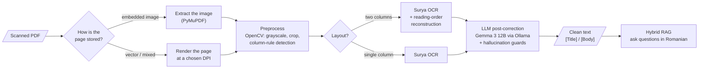
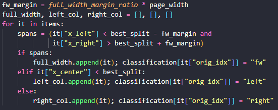
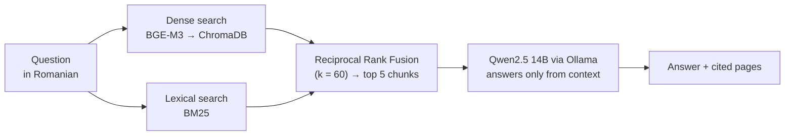
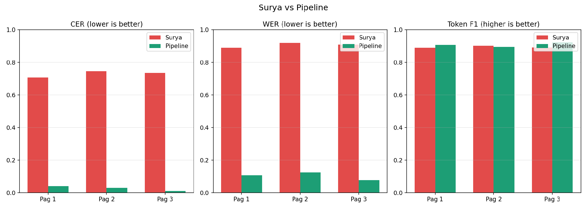
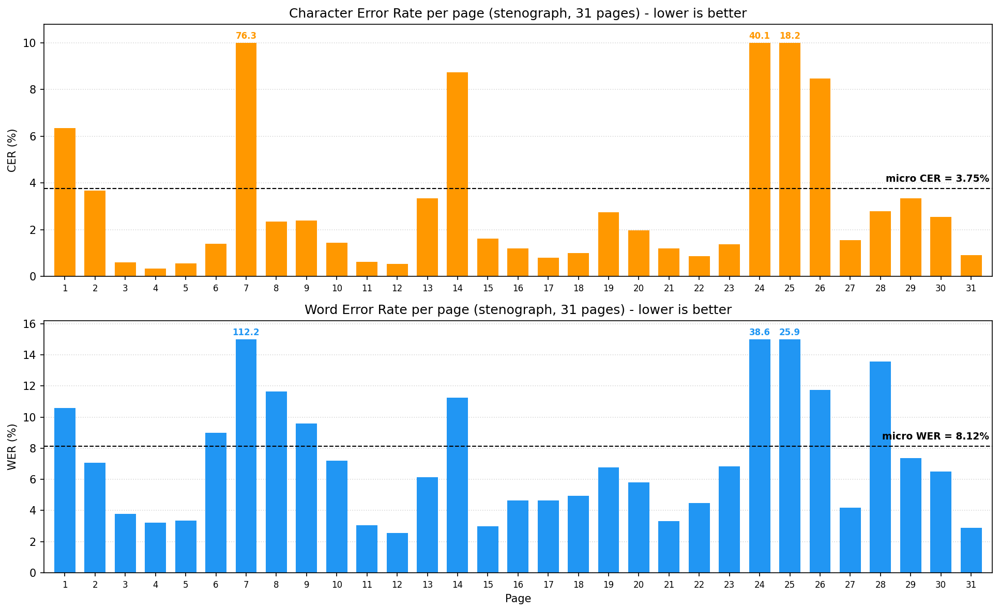

# Romanian Archive OCR — a local digitization pipeline


-000000)


**Scan in, searchable Romanian text out, with no cloud.**
A fully local pipeline that turns degraded 1970s–80s typewritten archives (two-column layouts, faded paper, Romanian diacritics) into clean text, then lets you ask questions about them in natural language, with sources.

Bachelor's thesis at UPB (Faculty of Automatic Control and Computers), 2026, built in collaboration with the **Institute of World Economy**, whose documents are confidential. That is why everything runs on a single local GPU machine.

<p align="center">
  <b>96.25% character accuracy</b> on an unseen 31-page document &nbsp;·&nbsp;
  <b>CER ~72% → under 4%</b> on two-column pages thanks to reading-order reconstruction
</p>

## The problem

Off-the-shelf OCR engines read a two-column page **top to bottom across both columns**, so sentences from the left and right column get interleaved into nonsense. The individual words are often recognized correctly; the **order** is what breaks the text.

## Pipeline



### 1. Reading-order reconstruction (the core idea)

Instead of working on pixels, it works on the **polygon coordinates** Surya returns for every text line:

1. Find the vertical gap between the columns (or use a detected column rule).
2. Classify every line by its horizontal position: **left column**, **right column**, or **full width** (titles that span both).
3. Emit the text in human reading order, tagged `[Title]` / `[Body]`, and stitch sentences that continue onto the next page.

<p align="center"></p>

### 2. LLM post-correction without hallucinations

A local **Gemma 3 12B** fixes OCR errors (broken diacritics, split words) under strict guards, because an LLM will happily "improve" a historical document:

- input wrapped in `<ocr_input>` delimiters, with stop tokens so the model cannot keep talking;
- output length capped relative to the input, `repeat_penalty` tuned to break loops without damaging diacritics;
- an **n-gram repetition detector** and a length-ratio check; if a page looks hallucinated, the pipeline falls back to the regex-cleaned text instead.

### 3. Hybrid RAG over the archive



- Clean text split into **300-token chunks with 50 overlap** (LlamaIndex `SentenceSplitter`).
- Dense and lexical results are fused **by rank, not by raw score**, so names and exact terms (BM25) and meaning (embeddings) both count.
- Several archives live in **separate collections** and can be switched in the UI without reindexing.

## Results

**Ablation: what does reordering alone change?** Same OCR, with and without the reading-order step:

<p align="center"></p>

CER and WER fall sharply while **token F1 stays flat**: the words were already recognized, only their order was wrong.

**End to end on an unseen 31-page document (raw scans):** micro **CER 3.75%**, **WER 8.12%**, median page CER around 1.6%. The spikes (pages 7, 24, 25) are short or physically degraded pages.

<p align="center"></p>

It also handles double-page scans with no special rule.

## Project structure

```text
├── main.py                  # desktop app (PySide6): load PDF, run OCR, run LLM correction
├── gui/                     # panels, background workers (QThread), zoomable page viewer
├── ExtractImages.py         # pull embedded page images out of the PDF (PyMuPDF)
├── preprocess/
│   └── PrepareForOCR.py     # OpenCV: grayscale, crop to content, column-rule and layout detection
├── Surya3.py                # two-column OCR + reading-order reconstruction + [Title]/[Body] tagging
├── SuryaNORMAL.py           # single-column OCR
├── llm_postCorection.py     # Gemma 3 post-correction with hallucination guards
└── RAG_PROJECT/rag_romana/  # hybrid RAG: ingest.py, rag.py, Streamlit app.py
```

## Run it

Tested on WSL2 / Ubuntu with an NVIDIA RTX 4070 Ti Super.

```bash
# 1. Local models
curl -fsSL https://ollama.com/install.sh | sh
ollama pull gemma3:12b
ollama pull qwen2.5:14b-instruct-q4_K_M

# 2. Digitization app
pip install -r requirements.txt        # surya-ocr, PySide6, pymupdf, opencv-python, requests
python main.py

# 3. Question answering over the digitized text
cd RAG_PROJECT/rag_romana
pip install -r requirements.txt
python ingest.py                       # one collection per folder in data/
streamlit run app.py
```

The original archive documents are **not included**, as they are confidential; put your own PDFs in the app and your cleaned `.txt` pages in `RAG_PROJECT/rag_romana/data/<collection>/`.

## What I would improve

- Learn the column split per page instead of relying on a ratio threshold, for unusual layouts.
- Flag low-confidence lines for human review instead of correcting everything automatically.
- Expose the pipeline as an API with standard archival metadata (Dublin Core, EAD), the direction of my M.Sc. dissertation.
